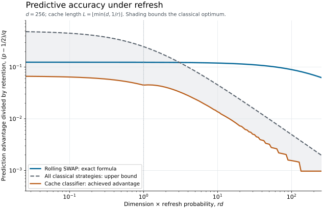

# Deterministic verification

These checks exercise the matrix identities and finite cache experiments used by the analytic proofs. They include the physical measurement instrument, rather than checking only its scalar recurrence. They also distinguish a global SWAP measurement from a local refinement with the same binary outcome probabilities.

## Reproduce the results

Use Python 3.11 or later. From the repository root:

```sh
python -m pip install -r verification/requirements.txt
python verification/run_checks.py
python verification/plot_frontier.py
```

The first script writes [results.json](results.json). The plot script writes [frontier.svg](frontier.svg) and its numeric [frontier.csv](frontier.csv). The checked environment used Python 3.12.14, NumPy 2.3.5, and Matplotlib 3.10.8. The matrix checks use a fixed seed and a tolerance of $`10^{-12}`$; their result file records pass/fail and rounded nonzero observables so insignificant floating-point differences do not alter its interpretation. The cache enumeration uses exact rational arithmetic.

## What is checked

| Component | Calculation | Cases |
|---|---|---|
| Haar posterior | Contract the exact symmetric-projector moment with a positive training effect; compare with $`(I+m\tau)/(d+m)`$ | $`d=2,3`$, $`m=1,2`$; eight effects per pair |
| Conditional classical bound | Evaluate the trace-distance decision probability and its bound; check saturation for a highest-weight effect | The same four dimension/copy pairs |
| Retained-memory instrument | Apply both global SWAP projectors to full density matrices, trace out the input, and evaluate outcome probabilities, accuracy, and trace-distance contraction | Ten state triples in each of $`d=2,3`$ |
| Coherent circuit | Compose controlled pair swaps with one shared ancilla and extract the two measurement Kraus operators | One and two qubits per register |
| Local-refinement distinction | Compare the global instrument with separately measured local SWAP observables | Two qubits per register; retained states differ by trace distance $`1/2`$ |
| Cache prediction | Enumerate reset flags, raw outcomes, and preceding true labels, integrating each independent epoch by exact Dirichlet moments | Three finite experiments |
| Stable cache evaluation | Compare a nonnegative moment expansion and renewal recurrence with exact rational values | Twelve dimension/rate pairs |

The exhaustive cache calculations give these exact advantages above one half:

| Dimension | Cache length | Refresh probability | Exact advantage |
|---|---|---|---|
| 2 | 1 | $`1/4`$ | $`1/32`$ |
| 2 | 3 | $`1/3`$ | $`593/38880`$ |
| 3 | 3 | $`2/5`$ | $`149/7200`$ |

The finite enumeration does not call the renewal recurrence. Agreement between those calculations checks the conditioning on refresh histories and hidden signal/background labels.

## The cache calculation used in the figure

For a Haar coordinate $`p\sim\mathrm{Beta}(1,d-1)`$, define

```math
z=(p+1/d)/2,
\qquad h_\ell=\mathbb E(1-z)^\ell,
\qquad
\Delta_\ell=-d\,\mathbb E[(p-1/d)(1-z)^\ell].
```

Let $`G_m`$ be the probability that $`m`$ consecutive preceding outcomes avoid a fixed coordinate, after averaging their independent source epochs. A renewal decomposition gives

```math
G_0=1,
\qquad
G_m=q^{m-1}h_m+
r\sum_{k=1}^{m-1}q^{k-1}h_kG_{m-k}.
```

The exact cache advantage is therefore

```math
b_{\mathrm{cache}}(L)
=\frac12\left[
q^L\Delta_L+
r\sum_{a=1}^{L-1}q^aG_{L-a}\Delta_a
\right].
```

The rational code evaluates these expressions with exact Dirichlet moments. For plotting, alternating polynomial expansions would cause unnecessary cancellation. Instead, put $`\alpha=1-1/(2d)`$ and $`\beta=(d-1)/(2d)`$. Then $`1-z=\alpha(1-p)+\beta p`$. Its Bernstein expansion has nonnegative beta-binomial weights. The identity

```math
\Delta_\ell
=\frac{\ell(d-1)}{2d(d+1)}
\mathbb E_{u\sim\mathrm{Beta}(2,d)}
\left[\alpha(1-u)+\beta u\right]^{\ell-1}
```

also has only nonnegative terms. These finite sums and the positive renewal recurrence produce the figure without sampling, numerical integration, or subtracting nearly equal moments.



The figure fixes $`d=256`$ and uses $`L=\lfloor\min(d,1/r)\rfloor`$. It divides each advantage by $`q=1-r`$ to expose the dimension-times-refresh crossover. The quantum curve is the exact formula for the particular rolling-SWAP strategy. The classical upper curve is the Jensen bound valid for every classical-record strategy. The lower curve is the actual cache classifier, evaluated from the displayed recurrence. The shaded interval contains the unknown exact optimal classical advantage; it is not a fitted optimum.

## Scope

The full-dimensional identities are proved in the [science notes](../science/quantum_prediction.md) and [posterior proof](../science/haar_posterior.md). Finite checks cannot establish the asymptotic prediction bounds, construct a unitary design, or certify a hardware noise model. No hardware performance or approximate-design sampling experiment is inferred from these results.
